<!-- Every card is an animated SVG drawn by cards.py and refreshed daily by
     .github/workflows/cards.yml. Spacing is baked into the SVGs, so keep each row on one line
     with no spaces between the images. -->

 
 
 
<picture><source media="(prefers-color-scheme: dark)" srcset="./cards/title-work-dark.svg" /></picture> 
 
 

<a href="https://sriraj-portfolio.vercel.app">portfolio</a> &nbsp;/&nbsp; <a href="https://www.linkedin.com/in/sriraj-w-v-p-s-2b2854280/">linkedin</a> &nbsp;/&nbsp; <a href="https://www.instagram.com/w.v.p.s.sriraj_10/">instagram</a> &nbsp;/&nbsp; <a href="https://x.com/Wsriraj">x</a> &nbsp;/&nbsp; <a href="https://www.youtube.com/@w.v.p.ssriraj10">youtube</a> &nbsp;/&nbsp; <a href="https://www.facebook.com/wvps.sriraj/">facebook</a> &nbsp;/&nbsp; <a href="https://in.pinterest.com/wvpssriraj10/">pinterest</a> &nbsp;/&nbsp; <a href="https://www.quora.com/profile/W-V-P-S-SRIRAJ-10">quora</a>

